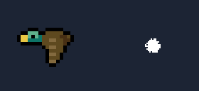
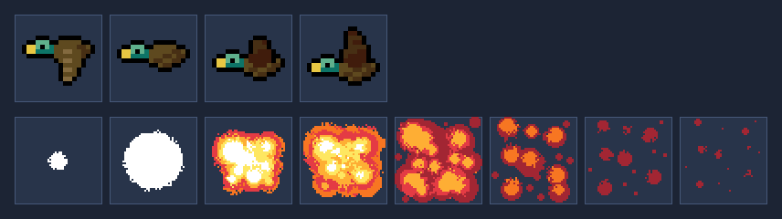

# SpriteAnimation

**Cómo animar sprites en Java, con el código bien organizado.**

Una ventana con un pato que vuela y una explosión, hechos con Swing y Java2D. Es pequeña, pero tiene lo que complica un programa de verdad: estado que cambia, dibujo, ratón y varios hilos. Sirve para ver cómo se reparte todo eso entre clases con MVP, interfaces e inyección de dependencias.

<p align="center">
  
</p>

## Para quién es

- **Alumnos de 2º de DAM**, en el módulo de videojuegos y en Programación de Servicios y Procesos. Es material de consulta: se abre cuando surge una duda concreta, no se sigue de principio a fin.
- **Docentes** que quieran un ejemplo pequeño y completo para explicar en clase cómo se estructura una aplicación con animación e hilos.

## Qué se aprende

- **Sprites:** recortar una hoja de sprites en fotogramas y avanzarlos con el tiempo, no con el repintado.
- **MVP:** qué hace el modelo, qué hace la vista y por qué el presentador es el único que habla con los dos.
- **Interfaces:** tres contratos en el paquete `contract`, cada uno en su archivo: `PresenterContract` (lo que la vista puede pedir al presentador), `ViewContract` y `ModelContract` (lo que el presentador puede pedir a la vista y al modelo). Los sprites no salen del modelo: la vista recibe de cada uno un `SpriteView`, un record con una copia de su imagen, su posición, su nombre y su velocidad.
- **Inyección de dependencias:** quién crea a quién y por qué cada clase recibe lo que necesita en lugar de crearlo.
- **Hilos:** un hilo por sprite, uno de pintado y el de eventos de Swing, cada uno en su capa, y cómo comparten datos sin pisarse.

## Las hojas de sprites

Dos hojas, cada una con su ritmo. En la demo, la velocidad de pintado y la de cada animación se cambian por separado con la rueda del ratón.



## El material

**[MVP, interfaces e inyección de dependencias](https://jumibot.github.io/SpriteAnimation/docs/material/mvp-interfaces-inyeccion.html)**: el documento para alumnos, con menú y buscador. Explica las tres piezas de MVP, el contrato método a método, quién crea a quién, cómo se monta la aplicación paso a paso, cómo encajan los hilos, un gesto del ratón de principio a fin, los errores frecuentes y ejercicios para practicar.

También se puede leer [en Markdown](docs/material/mvp-interfaces-inyeccion.md), sin maquetar.

## Ejecutar la demo

Necesitas el **JDK 21**. No hace falta Gradle ni Maven: los scripts compilan con `javac` y ejecutan con `java`.

| Qué | Windows | Linux, macOS o Git Bash |
| --- | --- | --- |
| Ejecutar la demo | `ejecutar.cmd` | `./ejecutar.sh` |
| Pasar las pruebas | `probar.cmd` | `./probar.sh` |

Las pruebas son cuatro: `PresenterTest` prueba el presentador sin ventana, con una vista y un modelo falsos; `SpriteSheetTest` comprueba el recorte de las dos hojas; `ModelTest`, que el modelo da copias de sus fotogramas, y `MouseTest` abre la ventana de verdad y mueve el ratón solo, con `java.awt.Robot`: gira la rueda sobre cada cifra del HUD y arrastra cada sprite. Mientras dura, unos segundos, no toques el ratón.

En **VS Code**, abre la carpeta del repositorio y usa *Terminal > Ejecutar tarea…*: «Ejecutar demo» o «Probar». Para depurar con puntos de ruptura y F5, instala el Extension Pack for Java:

```text
code --install-extension vscjava.vscode-java-pack
```

## Estado

- **Documentación:** el material para alumnos y las decisiones de diseño están escritos.
- **Hojas de sprites:** incluidas, en `src/main/resources/sprites/`.
- **Código de la demo:** listo, en `src/main/java/`, con pruebas en `src/test/java/`.

## Estructura del repositorio

```text
sf/decisiones/   Por qué la demo es como es, una decisión por archivo
docs/
  material/      Documento para alumnos (MVP, interfaces, inyección, hilos)
  specs/vision/  Visión y documento fundacional del proyecto
  identidad/     Estilos de los documentos HTML
  imagenes/      Imágenes de este README
src/main/java/   Código de la demo, en los paquetes main, model, view, presenter y contract
src/main/resources/sprites/
                 Hojas de sprites y su origen
src/test/java/   Pruebas: sin ventana, de las hojas, del modelo y con el ratón
.vscode/         Tareas «Ejecutar demo» y «Probar», y F5 para depurar
```

## Créditos

Las dos hojas de sprites son de dominio público ([CC0](https://creativecommons.org/publicdomain/zero/1.0/)). Se citan por cortesía:

- **Pato:** [«16x16 Duck»](https://opengameart.org/content/16x16-duck), de ARoachIFoundOnMyPillow, en OpenGameArt.
- **Explosión:** [«Explosion»](https://opengameart.org/node/132621), de Pavel Kutejnikov, en OpenGameArt.

Más detalle en [`ORIGEN.md`](src/main/resources/sprites/ORIGEN.md).

## Licencia

- **Código:** [MIT](LICENSE).
- **Material de `docs/`:** [CC BY 4.0](docs/LICENSE). Se puede copiar y adaptar citando la fuente.

Las hojas de sprites son de dominio público (CC0), como se indica en los créditos.
